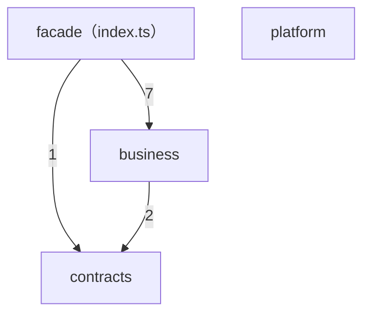

<!-- generated by scripts/gen-docs.mjs — DO NOT EDIT -->
> 本页由生成器产出（npm run docs:gen）：模块依赖由 src/ 相对 import 实测聚合。

# 架构（模块依赖实测）

共 4 个节点、3 条目录级有向边（边上数字 = 实测相对 import 条数；同目录内部依赖不单列）。

## 模块职责

| 模块 | 职责（摘自代表文件头注释） |
| --- | --- |
| `facade（index.ts）` | L4 routing layer facade — the only public surface of this layer. |
| `business` | Intake port (stub) — pure routing-rule lookup peeled alongside the routing layer. |
| `contracts` | 判定端口：本文件只保留语义判定契约（场景联合 + 网关形状）——routing 是纯路由面，不拥有引擎状态转变。 |
| `platform` | 安全 JSON 与字符串工具（对应 Go internal/infra/util 的常用面）。 |
